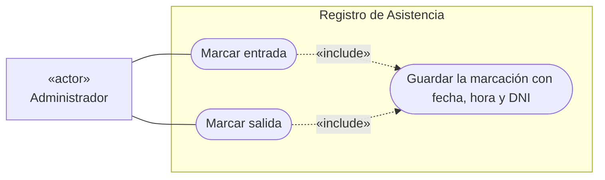

# Diagrama de casos de uso de asistencia

El administrador busca al empleado por nombre y lo selecciona por su DNI. Tanto la entrada como la salida requieren guardar la marcación con el DNI y capturar la fecha y hora automáticamente.

## Reglas de la marcación

- **Entrada.** Se acepta si el empleado aún carece de una entrada en la fecha de Lima.
- **Salida.** Se acepta si el empleado tiene una entrada abierta en esa fecha y puede registrar su primera salida del día. El par completo cuenta como asistencia de ese día.
- **Cambio de fecha.** La entrada sin salida queda incompleta en el historial. Al día siguiente se puede marcar una nueva entrada.

[[Diagrama-General|Diagrama general]] · [[Requisitos Funcionales#RF-08 · Validar la asistencia por día|Regla de asistencia por día]].
