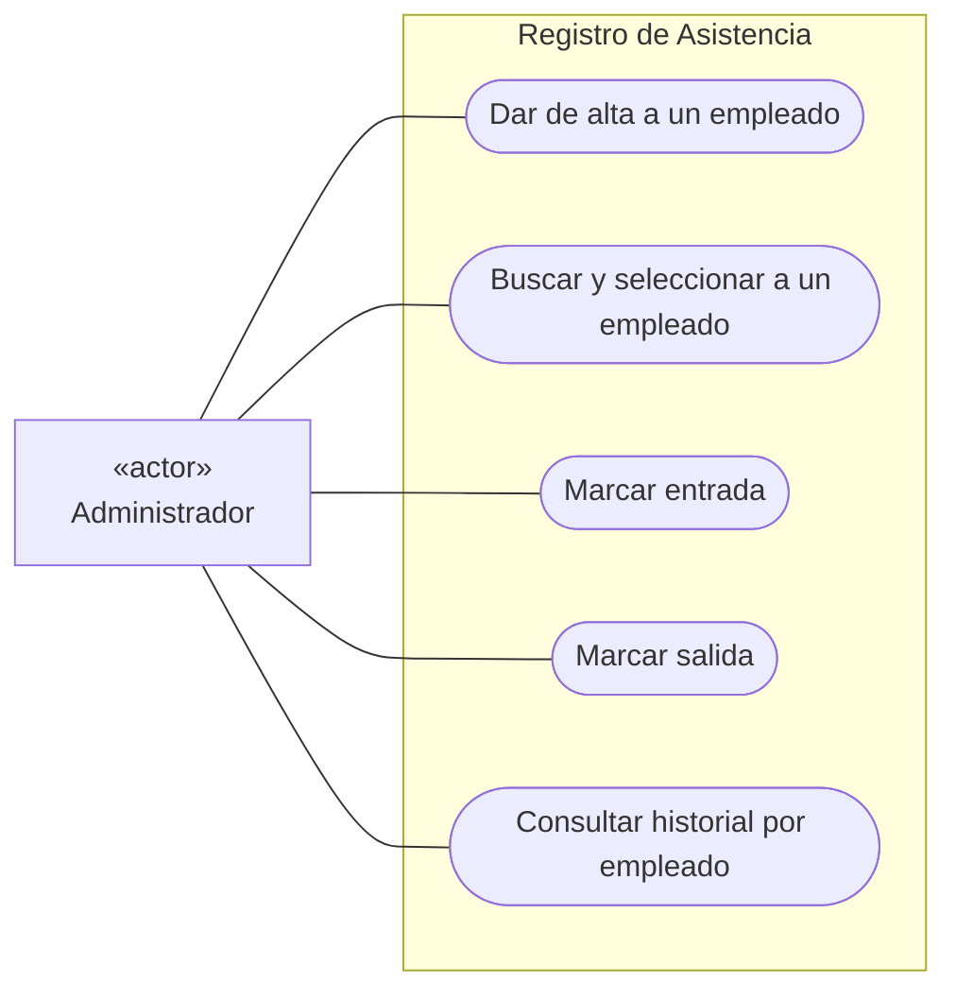

# Diagrama general de casos de uso

El administrador es el único actor de la demo. El recuadro delimita las funciones del sistema y las líneas continuas muestran las acciones que puede iniciar el administrador.

[[Diagrama-Personal|Alta, búsqueda e historial]] · [[Diagrama-Asistencia|Marcación de asistencia]]

Referencias: [[Actores]] · [[Alcance-MVP]].
