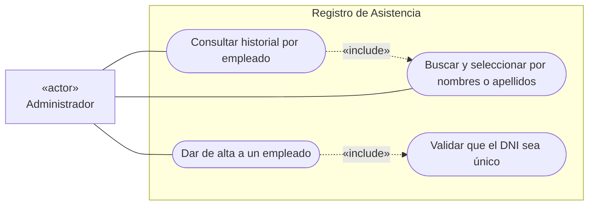

# Diagrama de casos de uso del personal

El administrador realiza el alta con nombres, apellidos y DNI, y puede indicar el puesto. La búsqueda usa los nombres o apellidos y muestra el DNI de cada resultado. Las flechas punteadas con `«include»` indican comportamientos requeridos por el caso de uso que apunta a ellos.

El alta se rechaza si el DNI ya está registrado. Si hay empleados con el mismo nombre, el administrador distingue los resultados por DNI y consulta las marcaciones de la persona seleccionada.

[[Diagrama-General|Diagrama general]] · [[Requisitos Funcionales]].
