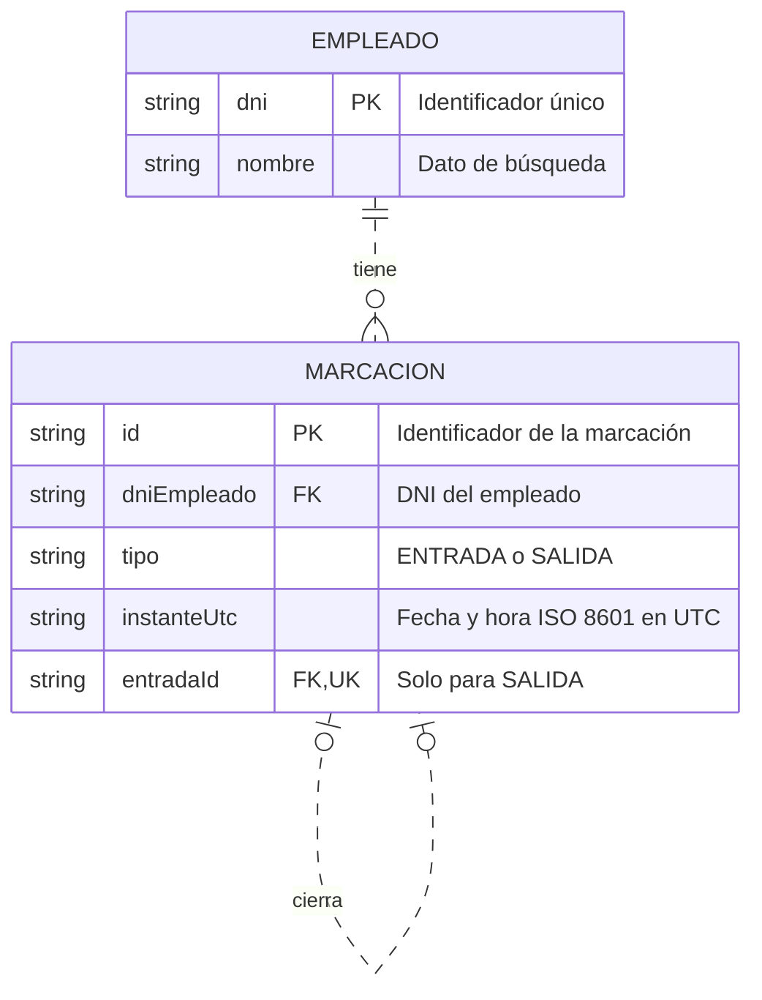

# Diagrama de modelo de datos

El MVP guarda los empleados y sus marcaciones en `localStorage`. Cada marcación pertenece a un solo empleado. Un empleado puede tener cero o muchas marcaciones.

`PK` identifica un registro. `FK` señala la referencia a otro registro. `UK` indica que el valor debe ser único cuando está presente. Estas reglas las aplica la aplicación al guardar los datos en el navegador.

## Reglas del modelo

- **Identificación.** El DNI se guarda como texto para conservar ceros iniciales. El nombre puede repetirse y se usa para buscar.
- **Límite diario.** Las nuevas marcaciones se limitan a una entrada y una salida por DNI y fecha de Lima.
- **Vínculo de entrada y salida.** Al guardar una salida, `entradaId` indica qué entrada cierra. Deben corresponder al mismo DNI y a la misma fecha de Lima.
- **Fecha de asistencia.** La aplicación calcula la fecha de Lima a partir de `instanteUtc` usando `America/Lima`. El día cuenta como asistencia cuando existe un par completo en esa fecha. Una entrada sin salida queda incompleta al cambiar el día y el administrador puede registrar una entrada nueva.

[[Alcance-MVP|Alcance del MVP]] · [[Requisitos Funcionales#RF-07 · Conservar los datos en el navegador|Guardado local]] · [[Requisitos Funcionales#RF-08 · Validar la asistencia por día|Regla diaria de asistencia]].

[[Modelo-de-Datos|Modelo de datos y diccionario de campos]].
