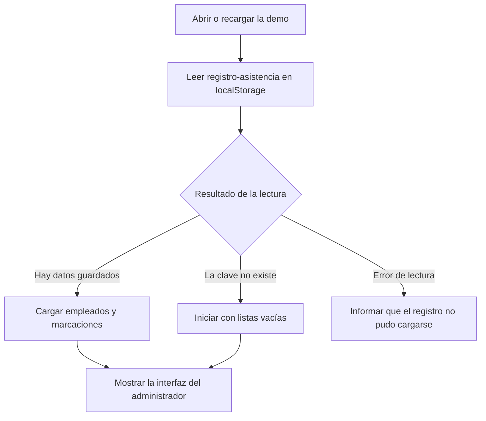
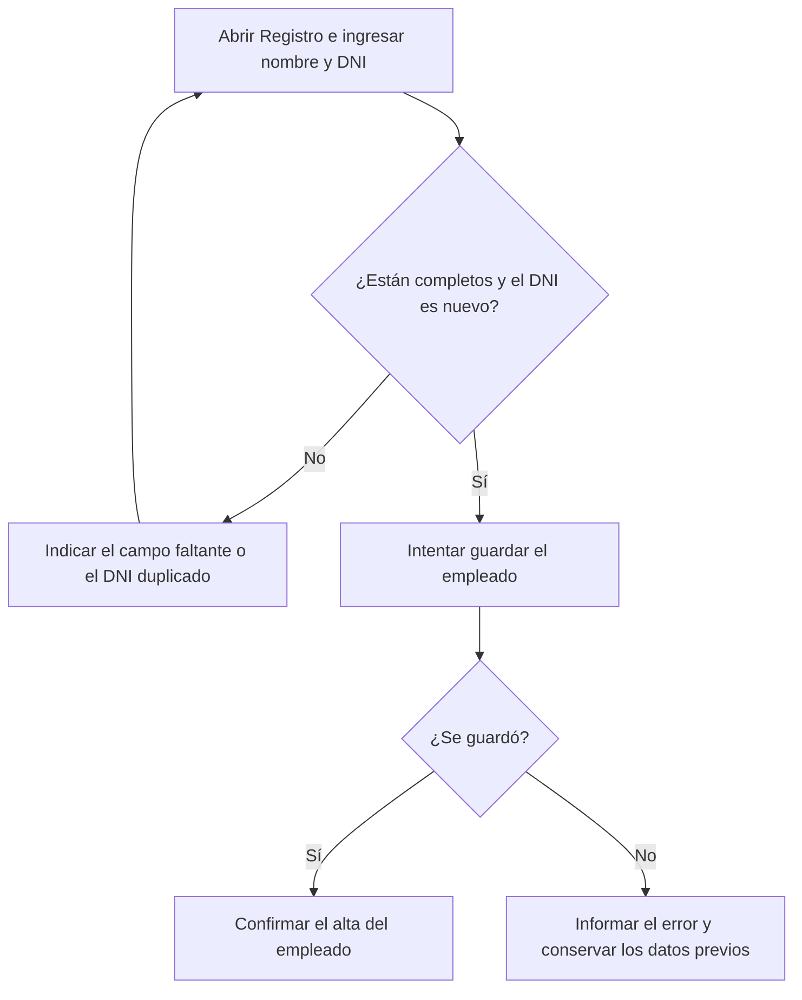
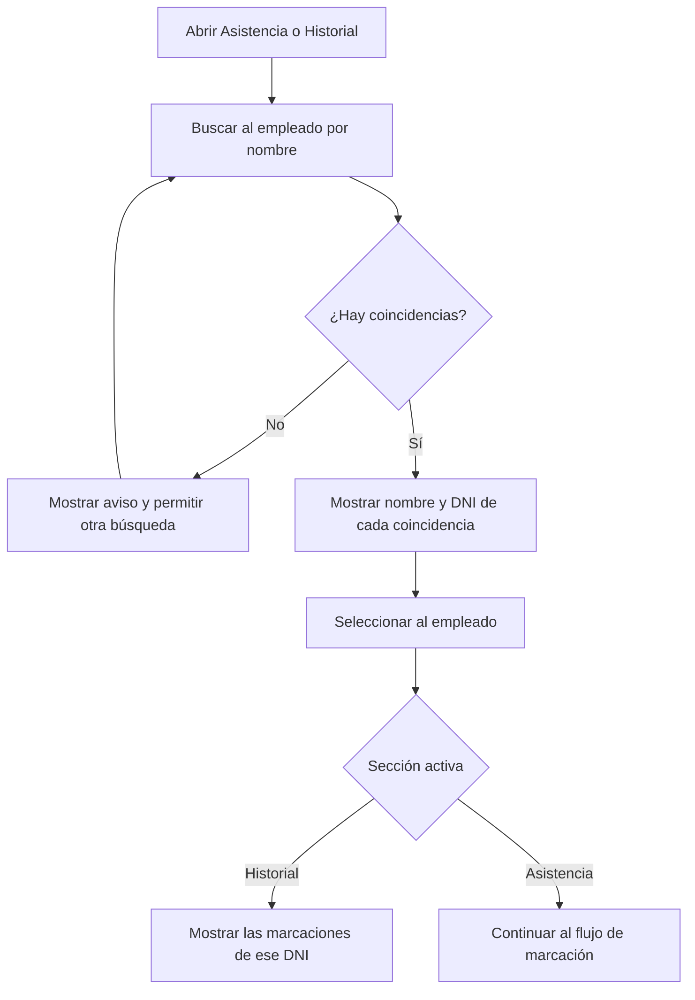
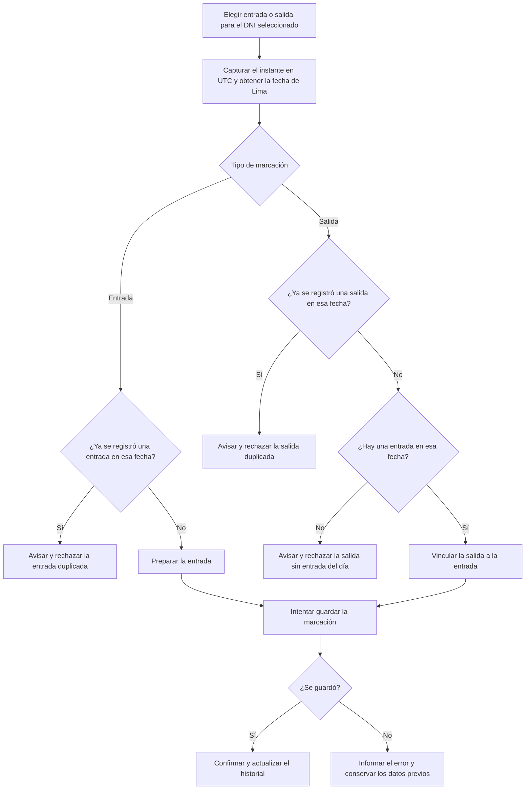

# Flujos del MVP

El administrador realiza el flujo completo desde el celular. La demo abre directamente en el navegador y conserva el personal y las marcaciones en ese mismo navegador. [[docs/06-Arquitectura/Arquitectura General|Arquitectura general]]

La navegación ofrece **Registro** para dar de alta y ver al personal, **Asistencia** para marcar e **Historial** para consultar los registros por empleado. Al cambiar entre Asistencia e Historial, la aplicación conserva el DNI seleccionado durante esa sesión.

## Abrir o recargar la demo

Después de recargar, el administrador puede volver a buscar a un empleado y consultar sus movimientos. Las validaciones usan la fecha actual de Lima. [[HU-07.Retomar el registro después de recargar|Historia de recuperación]]

## Dar de alta a un empleado

Después del alta, el empleado aparece en **Personal registrado** y queda disponible en la búsqueda de las otras vistas. Dos empleados pueden compartir el nombre si tienen DNI distintos. [[HU-01.Dar de alta a un empleado|Historia de alta]]

## Buscar, seleccionar y consultar

El historial muestra el tipo, la fecha y la hora de Lima con segundos. Si el empleado aún carece de marcaciones, la aplicación indica que su historial está vacío. [[HU-02.Buscar y seleccionar a un empleado|Historia de búsqueda]] · [[HU-06.Consultar el historial de un empleado|Historia de consulta]]

## Marcar entrada o salida

El límite de una entrada y una salida se aplica al DNI seleccionado y a la fecha de Lima calculada al marcar. Al guardar una salida válida, el par cuenta como asistencia de ese día. [[HU-03.Marcar una entrada|Historia de entrada]] · [[HU-04.Marcar una salida|Historia de salida]]

## Cambio de fecha en Lima

| Situación | Resultado |
| --- | --- |
| La entrada aún no tiene salida durante su fecha de Lima. | Sigue abierta y el administrador puede cerrarla con una salida de esa misma fecha. |
| Llega la medianoche en Lima con una entrada sin salida. | La entrada queda incompleta en el historial. Si fue la única marcación, el día anterior no cuenta como asistencia. |
| El administrador marca en la fecha nueva. | Puede comenzar con una nueva entrada. Una salida requiere una entrada abierta en esa fecha. |

El estado se obtiene de las marcaciones guardadas y de la fecha de Lima al consultar o intentar marcar. [[HU-05.Registrar asistencia en un día nuevo|Historia de cambio de día]] · [[Modelo-de-Datos|Modelo de datos]]
