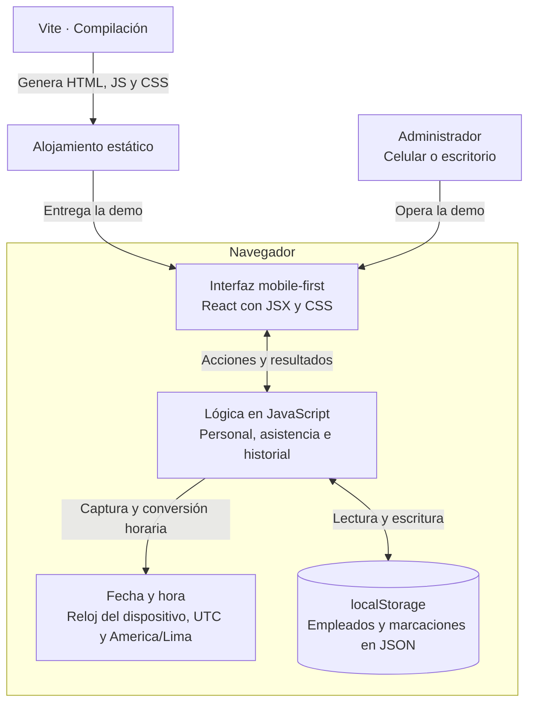

# Diagrama de arquitectura general

La demo se distribuye como un sitio estático. El administrador realiza todo el flujo en su navegador, con una interfaz diseñada primero para celular.

## Cómo funciona

- **Carga.** Vite genera los archivos de producción. El alojamiento estático los entrega y la aplicación recupera los registros disponibles en el navegador.
- **Operación.** La interfaz recibe las acciones del administrador. JavaScript valida el DNI único y las reglas de entrada y salida. La aplicación obtiene la hora del dispositivo, guarda el instante en UTC y calcula el día de asistencia en `America/Lima`.
- **Persistencia.** Los empleados y las marcaciones se guardan en `localStorage` del navegador. La aplicación confirma las escrituras exitosas y recupera los datos al recargar la demo en el mismo navegador.

[[Alcance-MVP|Alcance del MVP]] · [[Modelo-de-Datos|Modelo de datos]] · [[Requisitos-No-Funcionales|Requisitos no funcionales]].
